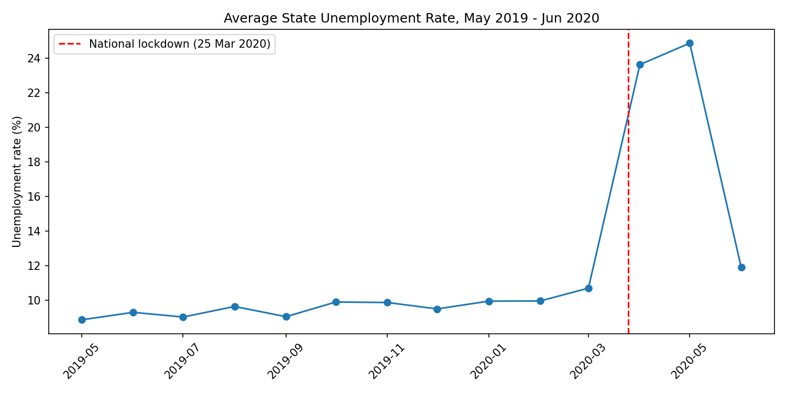
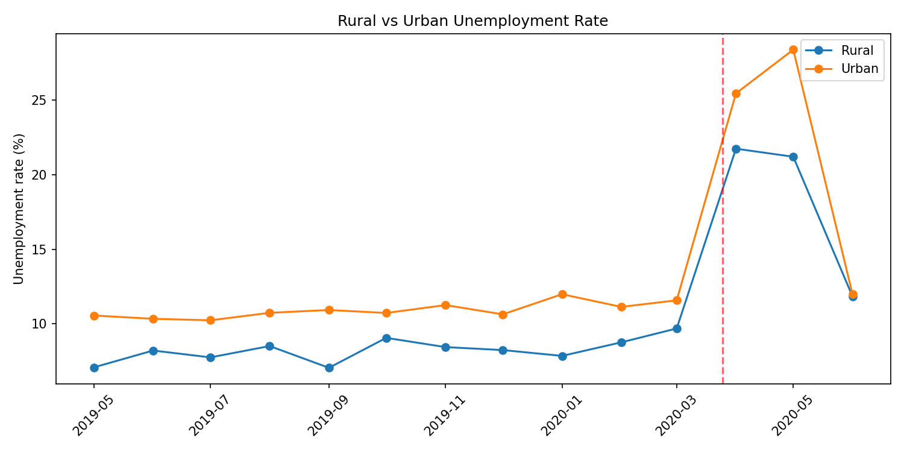
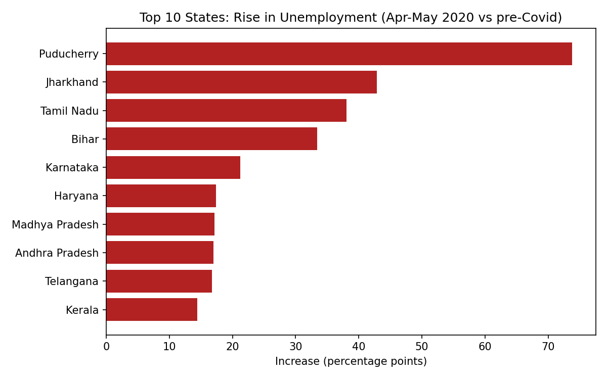
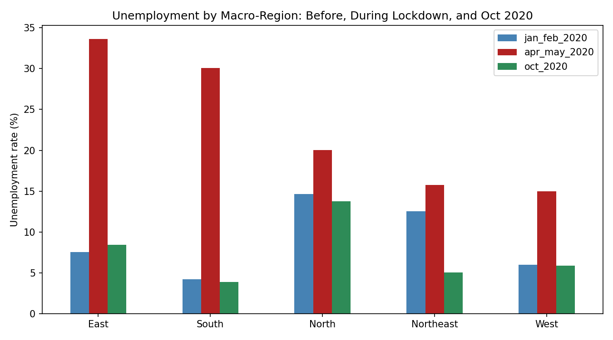
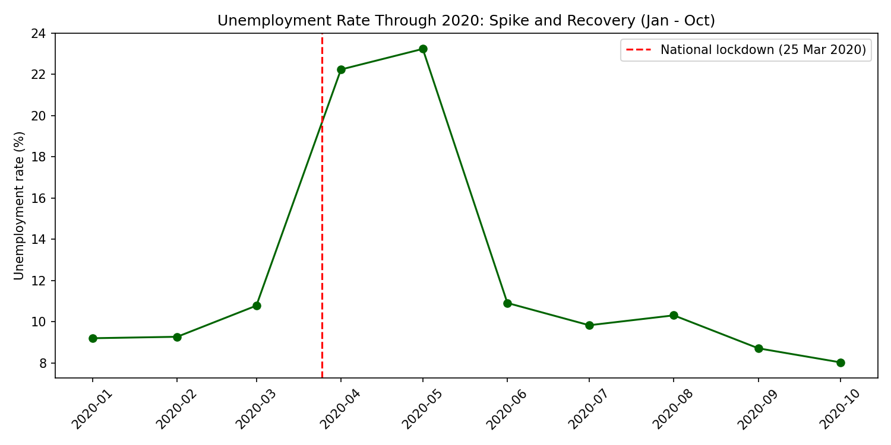

# Unemployment Analysis in India (Covid-19 Impact)

An end-to-end data pipeline and analysis of monthly unemployment in India, May 2019 to Oct 2020.
Raw CSVs are cleaned with **Python/Pandas**, loaded into a **SQLite** database, queried with **SQL**, and visualised with **Matplotlib**.

Built as part of the CodeAlpha Data Science internship task *"Unemployment Analysis with Python"*.

## Pipeline

```
data/raw/*.csv  ->  src/etl.py (clean + validate)  ->  SQLite (data/unemployment.db)
                                                           |
                                          src/analysis.py (SQL queries) -> outputs/tables/*.csv + outputs/figures/*.png
```

## Dataset

| File | Coverage | Granularity |
|---|---|---|
| `Unemployment in India.csv` | May 2019 - Jun 2020 | State x Rural/Urban x month |
| `Unemployment_Rate_upto_11_2020.csv` | Jan 2020 - Oct 2020 | State x month, with macro-region (North/South/East/West/Northeast) |

Columns: estimated unemployment rate (%), estimated employed, estimated labour participation rate (%).

## Data cleaning (what the ETL fixes)

- Removed 28 fully blank rows from the first file (768 raw rows -> 740).
- Stripped stray whitespace in column names and text values; removed the hidden BOM character in the header.
- Parsed dates (`dd-mm-yyyy`) into real datetimes.
- Standardised frequency labels (`M` -> `Monthly`) and column names (snake_case).
- The second file has two columns called `Region`; the second one holds the macro-region and is renamed `macro_region`.
- The `longitude` and `latitude` columns in the second file are swapped (e.g. Andhra Pradesh latitude shows as ~79.7). They are corrected.
- Added a `period` label: `pre_covid` (before Mar 2020), `lockdown` (Apr-May 2020), `transition` (Mar 2020 and Jun 2020 onwards).
- Validation checks (no nulls, rates between 0 and 100, monthly frequency) run before loading; unit tests are in `tests/`.

## Key findings

**1. The lockdown caused a sharp spike.** The average state unemployment rate was about 9.5% before Covid (May 2019 - Feb 2020), then rose to 23.6% in April 2020 and 24.9% in May 2020, the national lockdown period.



**2. Urban areas were hit harder than rural areas.** Rural unemployment went from 8.1% to 21.5% (+13.4 points) during the lockdown; urban went from 10.8% to 26.9% (+16.1 points). In May 2020 the gap was widest: 28.4% urban vs 21.2% rural.



**3. The impact was very uneven across states.** Puducherry (+73.8 points), Jharkhand (+42.8), Tamil Nadu (+38.0), Bihar (+33.4) and Karnataka (+21.2) had the largest increases, while Jammu & Kashmir and Tripura showed no rise. Full table: `outputs/tables/state_impact.csv`.



**4. East and South India saw the biggest jump.** Between Jan-Feb and Apr-May 2020, the East went from 7.5% to 33.6% and the South from 4.2% to 30.1%. The North had the highest baseline (14.6%) but a smaller relative jump (to 20.0%).



**5. Recovery was fast.** The rate fell to about 10.9% in June 2020 and 8.0% by October 2020, which is below the Jan 2020 level of 9.2% in this dataset.



## Seasonality: what the data can and cannot say

The data covers only one pre-Covid period (May 2019 - Feb 2020), with a mild upward drift from about 8.9% to 10%. With less than one full year before the shock, **no seasonal pattern can be reliably identified**; a seasonal claim would need at least 2-3 years of monthly data.

## Policy implications (based on the findings above)

- Urban informal workers need faster income support during lockdowns, since unemployment rose most in urban areas.
- Support should be targeted by state rather than uniform: a few states (Puducherry, Jharkhand, Tamil Nadu, Bihar) account for the most extreme increases.
- The quick recovery suggests the shock was largely tied to the lockdown itself, so reopening plans matter as much as relief schemes.

## Limitations

- Averages are simple (unweighted) means of state-level rates, not an official national rate; large and small states count equally.
- The number of rows per month varies slightly (50-54) because some state/area series have missing months, and Chandigarh has no data for Apr-May 2020, so it is excluded from the state comparison.
- The two files overlap in Jan-Jun 2020 but cover different row sets (the second has no rural/urban split), so their monthly averages differ slightly and are not merged into one series.
- Values like Puducherry's 75% unemployment are extreme and come straight from the source data; they were not altered.
- This is descriptive analysis; it shows what happened, not what caused it.

## Project structure

```
unemployment-analysis-india/
├── unemployment_analysis.ipynb  # full walkthrough: inspect, clean, load, SQL, charts, findings
├── data/raw/                 # original CSVs
├── src/
│   ├── etl.py                # clean, validate, load to SQLite
│   └── analysis.py           # SQL queries -> tables + figures
├── tests/test_etl.py         # unit tests for the cleaning logic
├── outputs/
│   ├── figures/              # PNG charts
│   └── tables/               # CSV results of each SQL query
└── requirements.txt
```

## How to run

```bash
pip install -r requirements.txt
```

**Option 1: Jupyter notebook (step-by-step walkthrough with explanations)**

```bash
jupyter notebook unemployment_analysis.ipynb
```

Start Jupyter from the project root folder, then run all cells.

**Option 2: Scripts**

```bash
python src/etl.py          # builds data/unemployment.db
python src/analysis.py     # creates outputs/tables and outputs/figures
pytest                     # runs the tests
```

## Tech stack

Python, Pandas, NumPy, SQLite (SQL), Matplotlib, Jupyter, Pytest.

## Author

Anas Ali Tayyab, BS Data Science student, The Islamia University of Bahawalpur.
